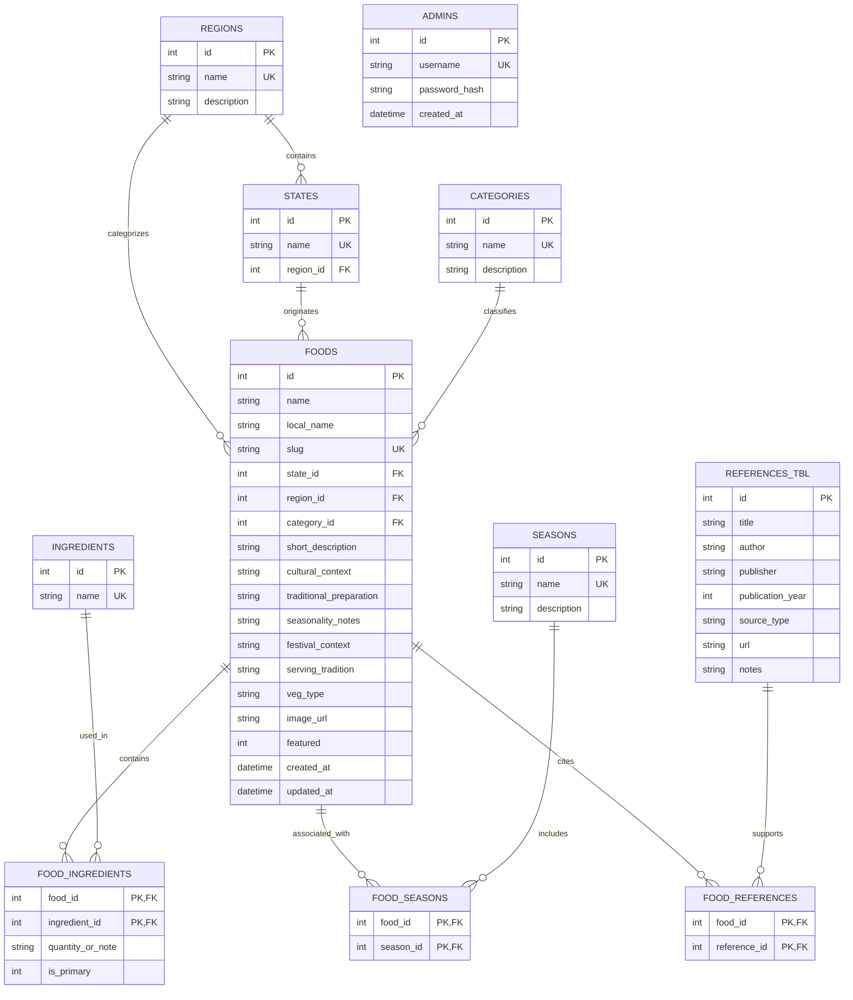

# Database Design & Architecture Document
**Bharat Bhojan – Traditional Indian Food Knowledge Information System**  
*Academic Project #25 | Technology Domain: Database Management Systems (DBMS)*

---

## 1. Overview & Design Philosophy

The database for **Bharat Bhojan** is designed as a fully normalized relational database adhering to **Third Normal Form (3NF)**. It balances structural integrity, relationship clarity, and query performance.

### Key Goals:
1. **Eliminate Redundancy:** Master information (e.g., region names, state names, categories, ingredients, seasons, references) is stored in dedicated master tables rather than repeated as text in the food records.
2. **Prevent Update & Deletion Anomalies:** Utilizing foreign key constraints with explicit `ON DELETE CASCADE` or `ON DELETE RESTRICT` rules ensures referential integrity.
3. **Many-to-Many Association Modeling:** A traditional dish typically uses multiple ingredients, belongs to multiple seasons, and cites multiple references. Associative junction tables (`food_ingredients`, `food_seasons`, `food_references`) model these many-to-many relationships cleanly.
4. **Student-Explainable SQL:** Standard SQL queries with parameterized bindings prevent SQL injection and remain understandable during viva examinations.

---

## 2. Entity-Relationship (ER) Diagram

---

## 3. Table-by-Table Architectural Description

### Table 1: `regions`
Stores the overarching geographical zones of India.
- **`id`** (INTEGER, Primary Key, Auto Increment): Unique identifier.
- **`name`** (TEXT, NOT NULL, UNIQUE): Name of the geographical zone (e.g., *East India*, *North India*, *South India*, *West India*, *Central India*, *North-East India*).
- **`description`** (TEXT): Cultural, geographical, and ecological overview of the zone.

### Table 2: `states`
Stores Indian states and territories, linked to their respective geographical region.
- **`id`** (INTEGER, Primary Key, Auto Increment): Unique state identifier.
- **`name`** (TEXT, NOT NULL, UNIQUE): State name (e.g., *Bihar*, *Punjab*, *Kerala*).
- **`region_id`** (INTEGER, Foreign Key referencing `regions(id)` ON DELETE RESTRICT): Prevents accidental deletion of a region if states depend on it.

### Table 3: `categories`
Defines culinary classifications for dishes.
- **`id`** (INTEGER, Primary Key, Auto Increment): Unique identifier.
- **`name`** (TEXT, NOT NULL, UNIQUE): Category title (e.g., *Main Dish*, *Bread & Flatbread*, *Sweet & Confectionery*, *Fermented Food*, *Beverage*).
- **`description`** (TEXT): Educational description of the category.

### Table 4: `seasons`
Represents the traditional seasonal cycles (*Shad-Ritu* and agricultural periods).
- **`id`** (INTEGER, Primary Key, Auto Increment): Unique identifier.
- **`name`** (TEXT, NOT NULL, UNIQUE): Season name (*Summer*, *Monsoon*, *Autumn*, *Winter*, *Spring*, *Year-round*).
- **`description`** (TEXT): Explains the Ritu's agro-climatic profile and customary dietary focus.

### Table 5: `foods` (Core Entity Table)
The central repository holding verified records for each traditional dish.
- **`id`** (INTEGER, Primary Key, Auto Increment): Primary key.
- **`name`** (TEXT, NOT NULL): Standard recognized name in English (e.g., *Litti Chokha*).
- **`local_name`** (TEXT): Native name in indigenous script (e.g., *लिट्टी चोखा* in Devanagari).
- **`slug`** (TEXT, NOT NULL, UNIQUE): URL-friendly unique identifier (e.g., `litti-chokha`).
- **`state_id`** (INTEGER, Foreign Key referencing `states(id)` ON DELETE RESTRICT).
- **`region_id`** (INTEGER, Foreign Key referencing `regions(id)` ON DELETE RESTRICT).
- **`category_id`** (INTEGER, Foreign Key referencing `categories(id)` ON DELETE RESTRICT).
- **`short_description`** (TEXT, NOT NULL): 1-2 sentence overview for card previews.
- **`cultural_context`** (TEXT, NOT NULL): Comprehensive narrative of cultural significance, history, and household variations.
- **`traditional_preparation`** (TEXT, NOT NULL): Traditional cooking techniques, tools, and vessel usage.
- **`seasonality_notes`** (TEXT, NOT NULL): Explanation of why the dish is eaten in specific seasons.
- **`festival_context`** (TEXT): Occasion, pooja, or festival associations.
- **`serving_tradition`** (TEXT): Customary accompaniments and serving customs.
- **`veg_type`** (TEXT, NOT NULL, CHECK(`veg_type IN ('Vegetarian', 'Non-Vegetarian')`)): Enforces valid dietary classification.
- **`image_url`** (TEXT): Path to local SVG asset or image file.
- **`featured`** (INTEGER, DEFAULT 0, CHECK(`featured IN (0, 1)`)): Flag for landing page showcase.
- **`created_at`** (TEXT, DEFAULT `(datetime('now'))`): Creation timestamp.
- **`updated_at`** (TEXT, DEFAULT `(datetime('now'))`): Last update timestamp.

### Table 6: `ingredients`
A normalized master table of unique pantry ingredients, agricultural grains, and spices.
- **`id`** (INTEGER, Primary Key, Auto Increment): Unique identifier.
- **`name`** (TEXT, NOT NULL, UNIQUE): Unique ingredient name (e.g., *Sattu*, *Mustard Oil*, *Ajwain*).

### Table 7: `food_ingredients` (Associative Junction Table)
Resolves the Many-to-Many relationship between `foods` and `ingredients`.
- **`food_id`** (INTEGER, Foreign Key referencing `foods(id)` ON DELETE CASCADE): Deleting a food automatically cleans up its ingredient links.
- **`ingredient_id`** (INTEGER, Foreign Key referencing `ingredients(id)` ON DELETE RESTRICT): Prevents deleting an ingredient if dishes still use it.
- **`quantity_or_note`** (TEXT): Proportional guidance (e.g., *2 cups*, *1 tablespoon*).
- **`is_primary`** (INTEGER, DEFAULT 0, CHECK(`is_primary IN (0, 1)`)): Indicates whether this is a defining ingredient for the dish.
- **`PRIMARY KEY (food_id, ingredient_id)`**: Composite primary key ensuring no duplicate pairings.

### Table 8: `food_seasons` (Associative Junction Table)
Resolves the Many-to-Many relationship between `foods` and `seasons`.
- **`food_id`** (INTEGER, Foreign Key referencing `foods(id)` ON DELETE CASCADE).
- **`season_id`** (INTEGER, Foreign Key referencing `seasons(id)` ON DELETE RESTRICT).
- **`PRIMARY KEY (food_id, season_id)`**: Composite primary key.

### Table 9: `references_tbl`
Stores bibliographic citations, government records, and academic sources.
- **`id`** (INTEGER, Primary Key, Auto Increment): Unique identifier.
- **`title`** (TEXT, NOT NULL): Book, paper, or report title.
- **`author`** (TEXT): Author(s) or government department.
- **`publisher`** (TEXT): Publishing house or institution.
- **`publication_year`** (INTEGER): Year of publication.
- **`source_type`** (TEXT, NOT NULL): e.g., *Academic Book*, *Government Source*, *Journal*.
- **`url`** (TEXT): Link to archive or digital library if available.
- **`notes`** (TEXT): Annotations on content coverage.

### Table 10: `food_references` (Associative Junction Table)
Resolves the Many-to-Many relationship between `foods` and `references_tbl`.
- **`food_id`** (INTEGER, Foreign Key referencing `foods(id)` ON DELETE CASCADE).
- **`reference_id`** (INTEGER, Foreign Key referencing `references_tbl(id)` ON DELETE CASCADE).
- **`PRIMARY KEY (food_id, reference_id)`**: Composite primary key.

### Table 11: `admins`
Stores administrator credentials for portal management.
- **`id`** (INTEGER, Primary Key, Auto Increment): Unique identifier.
- **`username`** (TEXT, NOT NULL, UNIQUE): Login username.
- **`password_hash`** (TEXT, NOT NULL): 60-character bcrypt hash (passwords are never stored in plain text).
- **`created_at`** (TEXT, DEFAULT `(datetime('now'))`): Account registration timestamp.

---

## 4. Normalization Analysis

### First Normal Form (1NF)
- Every table contains atomic (indivisible) column values.
- No repeating groups or arrays stored in single text columns (e.g., ingredients and seasons are extracted into dedicated junction tables rather than comma-separated lists).
- Each table possesses a designated Primary Key.

### Second Normal Form (2NF)
- The database is in 1NF.
- All non-key attributes are fully functionally dependent on the entire primary key. In composite key tables (`food_ingredients`, `food_seasons`, `food_references`), linking attributes depend directly on the combination of `(food_id, ...)`.

### Third Normal Form (3NF)
- The database is in 2NF.
- There are no transitive dependencies (i.e., non-key attributes depending on other non-key attributes). For example, `state_name` and `region_name` are not stored inside the `foods` table; instead, foreign keys point to `states` and `regions` respectively.

---

## 5. Performance Indexes

To ensure sub-millisecond query execution during real-time filtering and searches:
- `idx_foods_state` on `foods(state_id)`
- `idx_foods_region` on `foods(region_id)`
- `idx_foods_category` on `foods(category_id)`
- `idx_foods_slug` on `foods(slug)`
- `idx_foods_featured` on `foods(featured)`
- `idx_foods_veg_type` on `foods(veg_type)`
- `idx_food_ingredients_food` on `food_ingredients(food_id)`
- `idx_food_ingredients_ing` on `food_ingredients(ingredient_id)`
- `idx_food_seasons_food` on `food_seasons(food_id)`
- `idx_food_seasons_season` on `food_seasons(season_id)`
