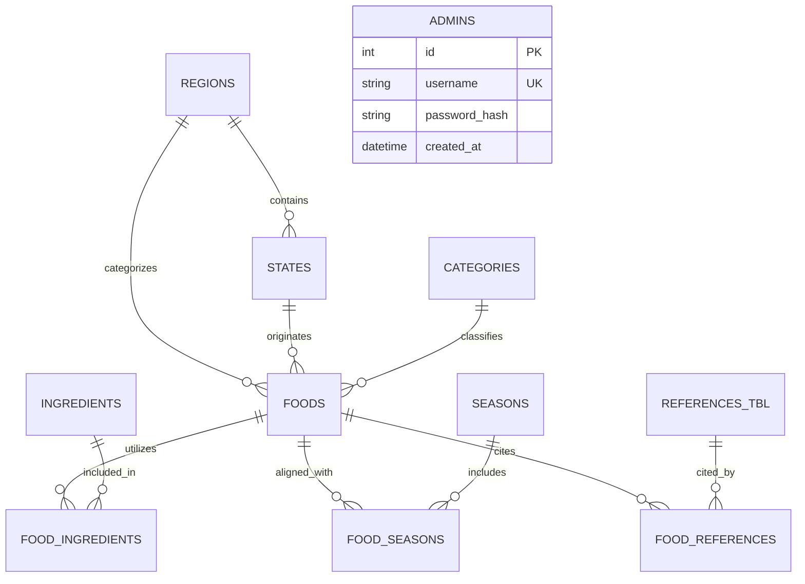

# Bharat Bhojan – Database Design & Viva Guide

A comprehensive, exam-ready guide detailing the relational database design, normalization analysis, table schemas, relationships, indexing strategy, and frequently asked database viva questions for **Bharat Bhojan**.

---

## 1. Entity-Relationship Overview

The database is designed in strict compliance with the **Third Normal Form (3NF)**. It cleanly decouples entities and models real-world Many-to-Many relationships using junction tables.



---

## 2. Exhaustive Table Specifications (11 Tables)

### Table 1: `regions` (Master Lookup)
* **Purpose:** Represents the 6 broad macro-geographical culinary zones of India (North, South, East, West, Central, North-East).
* **Columns:**
  * `id` (`INTEGER PRIMARY KEY AUTOINCREMENT`): Unique regional identifier.
  * `name` (`TEXT NOT NULL UNIQUE`): Zone name.
  * `description` (`TEXT`): Geographic and agro-climatic summary.
* **Justification:** Avoids hardcoding region strings in multiple state records, allowing centralized updates.

### Table 2: `states` (Entity Table)
* **Purpose:** Represents the 25 documented Indian states and union territories.
* **Columns:**
  * `id` (`INTEGER PRIMARY KEY AUTOINCREMENT`): Unique state identifier.
  * `name` (`TEXT NOT NULL UNIQUE`): Official state name.
  * `region_id` (`INTEGER NOT NULL`): Foreign key referencing `regions(id)`.
* **Constraints:** `FOREIGN KEY (region_id) REFERENCES regions(id) ON DELETE RESTRICT`.
* **Justification:** Enforces 1-to-Many relationship (One Region has Many States). `ON DELETE RESTRICT` prevents deleting a region that contains states.

### Table 3: `categories` (Master Lookup)
* **Purpose:** Classifies foods by culinary role (Main Dish, Bread / Flatbread, Sweet / Confection, Fermented Food, Beverage, etc.).
* **Columns:**
  * `id` (`INTEGER PRIMARY KEY AUTOINCREMENT`): Unique category identifier.
  * `name` (`TEXT NOT NULL UNIQUE`): Category title.
  * `description` (`TEXT`): Definition of the category.
* **Justification:** Standardizes food taxonomy across all regions.

### Table 4: `seasons` (Master Lookup)
* **Purpose:** Documents the six traditional Indian seasons (*Shad-Ritu*) plus Year-round availability (Summer / Grishma, Monsoon / Varsha, Autumn / Sharad, Pre-Winter / Hemanta, Winter / Shishira, Spring / Vasanta, Year-round).
* **Columns:**
  * `id` (`INTEGER PRIMARY KEY AUTOINCREMENT`): Unique season identifier.
  * `name` (`TEXT NOT NULL UNIQUE`): English and Sanskrit seasonal designation.
  * `description` (`TEXT`): Agro-climatic characteristics and traditional dietary guidance.
* **Justification:** Eliminates repetition and allows foods to link to multiple seasonal cycles.

### Table 5: `foods` (Core Central Entity)
* **Purpose:** The primary table storing traditional food records and their cultural narratives.
* **Columns:**
  * `id` (`INTEGER PRIMARY KEY AUTOINCREMENT`): Surrogate primary key.
  * `name` (`TEXT NOT NULL`): Common English / Romanized name (e.g., `"Litti Chokha"`).
  * `local_name` (`TEXT`): Indigenous name in regional/Devanagari script (e.g., `"लिट्टी चोखा"`).
  * `slug` (`TEXT NOT NULL UNIQUE`): URL-safe identifier (e.g., `"litti-chokha"`).
  * `state_id` (`INTEGER NOT NULL`): FK referencing `states(id)`.
  * `region_id` (`INTEGER NOT NULL`): FK referencing `regions(id)`.
  * `category_id` (`INTEGER NOT NULL`): FK referencing `categories(id)`.
  * `short_description` (`TEXT NOT NULL`): 1-2 sentence overview for cards and meta tags.
  * `cultural_context` (`TEXT NOT NULL`): Cultural history, community rituals, and social background.
  * `traditional_preparation` (`TEXT NOT NULL`): Traditional cooking methods, earthen tools, and flame types.
  * `seasonality_notes` (`TEXT NOT NULL`): Agro-climatic and harvest context.
  * `festival_context` (`TEXT`): Religious, ceremonial, or festival role (optional).
  * `serving_tradition` (`TEXT`): Accompaniments and presentation customs (optional).
  * `veg_type` (`TEXT NOT NULL CHECK(veg_type IN ('Vegetarian', 'Non-Vegetarian'))`): Strict dietary check.
  * `image_url` (`TEXT NOT NULL DEFAULT '/assets/images/placeholder.svg'`): Local SVG path.
  * `featured` (`INTEGER NOT NULL DEFAULT 0 CHECK(featured IN (0, 1))`): Homepage showcase flag.
  * `created_at` (`DATETIME DEFAULT CURRENT_TIMESTAMP`): Record creation audit timestamp.
  * `updated_at` (`DATETIME DEFAULT CURRENT_TIMESTAMP`): Last modification audit timestamp.
* **Foreign Key Actions:** `ON DELETE RESTRICT` for states, regions, and categories to preserve data integrity.

### Table 6: `ingredients` (Entity Table)
* **Purpose:** Master catalog of traditional raw materials, indigenous grains, native spices, and wild greens.
* **Columns:**
  * `id` (`INTEGER PRIMARY KEY AUTOINCREMENT`): Unique ingredient identifier.
  * `name` (`TEXT NOT NULL UNIQUE`): Normalized name (e.g., `"Sattu (Roasted Bengal Gram Flour)"`).
* **Justification:** Eliminates ingredient misspelling and allows cross-querying dishes that share common ingredients.

### Table 7: `references_tbl` (Bibliographic Master)
* **Purpose:** Stores verified citations, historical monographs, and government gazettes.
* **Columns:**
  * `id` (`INTEGER PRIMARY KEY AUTOINCREMENT`): Unique citation identifier.
  * `title` (`TEXT NOT NULL`): Book title or government gazette name.
  * `author` (`TEXT`): Author, historian, or issuing ministry.
  * `publication_year` (`INTEGER`): Year of publication.
  * `publisher` (`TEXT`): University press or government department.
  * `url` (`TEXT`): Official digital catalog link or gazette entry.
  * `source_type` (`TEXT NOT NULL`): Category (Gazette, Monograph, Peer-Reviewed Journal, etc.).
  * `notes` (`TEXT`): Brief academic annotation.
* **Note on Naming:** Named `references_tbl` because `REFERENCES` is an ANSI SQL reserved keyword.

### Table 8: `food_ingredients` (Junction Table: Foods ↔ Ingredients)
* **Purpose:** Resolves the Many-to-Many relationship between foods and ingredients.
* **Columns:**
  * `food_id` (`INTEGER NOT NULL`): FK referencing `foods(id)` with `ON DELETE CASCADE`.
  * `ingredient_id` (`INTEGER NOT NULL`): FK referencing `ingredients(id)` with `ON DELETE RESTRICT`.
  * `quantity_or_note` (`TEXT`): Traditional proportion (e.g., `"2 cups"`, `"pinch"`).
  * `is_primary` (`INTEGER DEFAULT 0 CHECK(is_primary IN (0, 1))`): Flag indicating core vs secondary ingredient.
* **Primary Key:** `PRIMARY KEY (food_id, ingredient_id)` (Composite Primary Key).

### Table 9: `food_seasons` (Junction Table: Foods ↔ Seasons)
* **Purpose:** Resolves the Many-to-Many relationship between foods and seasons.
* **Columns:**
  * `food_id` (`INTEGER NOT NULL`): FK referencing `foods(id)` with `ON DELETE CASCADE`.
  * `season_id` (`INTEGER NOT NULL`): FK referencing `seasons(id)` with `ON DELETE RESTRICT`.
* **Primary Key:** `PRIMARY KEY (food_id, season_id)` (Composite Primary Key).

### Table 10: `food_references` (Junction Table: Foods ↔ References)
* **Purpose:** Resolves the Many-to-Many relationship between foods and bibliographic citations.
* **Columns:**
  * `food_id` (`INTEGER NOT NULL`): FK referencing `foods(id)` with `ON DELETE CASCADE`.
  * `reference_id` (`INTEGER NOT NULL`): FK referencing `references_tbl(id)` with `ON DELETE RESTRICT`.
* **Primary Key:** `PRIMARY KEY (food_id, reference_id)` (Composite Primary Key).

### Table 11: `admins` (Authentication Entity)
* **Purpose:** Stores authenticated administrative credentials.
* **Columns:**
  * `id` (`INTEGER PRIMARY KEY AUTOINCREMENT`): Unique admin identifier.
  * `username` (`TEXT NOT NULL UNIQUE`): Administrative handle.
  * `password_hash` (`TEXT NOT NULL`): Salted bcrypt hash string.
  * `created_at` (`DATETIME DEFAULT CURRENT_TIMESTAMP`): Account creation timestamp.

---

## 3. Database Normalization Analysis

### First Normal Form (1NF)
* **Rule:** Each column must contain atomic (indivisible) values, and there must be no repeating groups.
* **In Bharat Bhojan:**
  * A naive design would store ingredients as a comma-separated string (`"sattu, mustard oil, garlic, green chilies"`) inside the `foods` table.
  * Our design normalizes this into separate rows in `ingredients` and `food_ingredients`. Each column contains exactly one atomic value.

### Second Normal Form (2NF)
* **Rule:** Must be in 1NF, and all non-key attributes must be fully functionally dependent on the primary key (no partial dependencies on a composite key).
* **In Bharat Bhojan:**
  * In the junction tables (`food_ingredients`, `food_seasons`, `food_references`), the composite primary key consists of two foreign keys (e.g., `(food_id, ingredient_id)`).
  * The non-key attributes (`quantity_or_note`, `is_primary`) depend on the *combination* of both the food and the ingredient, satisfying 2NF.

### Third Normal Form (3NF)
* **Rule:** Must be in 2NF, and there must be no transitive dependencies (non-key columns depending on other non-key columns).
* **In Bharat Bhojan:**
  * If the `foods` table stored `state_name` and `region_name`, `region_name` would depend on `state_name` rather than directly on `food_id` (`food_id -> state_id -> region_id`).
  * We eliminated this transitive dependency by separating `states` and `regions` into independent lookup tables. The `foods` table holds clean foreign keys.

---

## 4. Indexing Strategy

To guarantee rapid query response times during search and filtering, five dedicated B-Tree indexes are created in `database/schema.sql`:

```sql
CREATE INDEX IF NOT EXISTS idx_foods_slug ON foods(slug);
CREATE INDEX IF NOT EXISTS idx_foods_state ON foods(state_id);
CREATE INDEX IF NOT EXISTS idx_foods_region ON foods(region_id);
CREATE INDEX IF NOT EXISTS idx_foods_category ON foods(category_id);
CREATE INDEX IF NOT EXISTS idx_food_ingredients_food ON food_ingredients(food_id);
```

### Why These Indexes?
1. **`idx_foods_slug`:** Detail pages look up foods by slug (`WHERE slug = ?`). A B-Tree index reduces lookup time from $O(N)$ (table scan) to $O(\log N)$.
2. **`idx_foods_state`, `region`, `category`:** The Explore filter toolbar dynamically queries by state, region, or category. Indexing foreign keys accelerates SQL `JOIN` and `WHERE` filtering.
3. **`idx_food_ingredients_food`:** When rendering a dish detail page, the database joins `food_ingredients` to fetch all ingredients for that `food_id`. This index ensures instant retrieval.

---

## 5. SQLite vs MySQL Mapping

While the application runs locally on **SQLite** for zero-configuration simplicity, `docs/mysql-schema.sql` provides the identical architecture for MySQL/MariaDB environments:

| Feature / Data Type | SQLite Implementation | MySQL Implementation (`docs/mysql-schema.sql`) | Viva Explanation |
| :--- | :--- | :--- | :--- |
| **Auto-Increment Primary Key** | `INTEGER PRIMARY KEY AUTOINCREMENT` | `INT AUTO_INCREMENT PRIMARY KEY` | Automatically generates sequential integer IDs. |
| **Short Text / Names** | `TEXT NOT NULL` | `VARCHAR(150) NOT NULL` | SQLite uses dynamic typing; MySQL requires fixed maximum length allocation. |
| **Long Descriptions / History** | `TEXT NOT NULL` | `TEXT NOT NULL` | Stored off-row for large textual content. |
| **Boolean Flags** | `INTEGER CHECK(featured IN (0, 1))` | `TINYINT(1) DEFAULT 0` | SQLite uses 0/1 integers; MySQL uses TINYINT aliases. |
| **Cascade Deletes** | `ON DELETE CASCADE` | `ON DELETE CASCADE` | Identical syntax: child junction records are deleted when the parent food is deleted. |
| **Engine / Charset** | Default SQLite B-Tree | `ENGINE=InnoDB DEFAULT CHARSET=utf8mb4` | InnoDB supports foreign keys, transactions, and UTF-8 multibyte characters for Hindi script. |

---

## 6. Top Database Viva Questions & Sample Answers

#### Q1: What is a Foreign Key and why did you use it?
**Answer:** A Foreign Key is a field in one table that uniquely identifies a row in another table, referencing its Primary Key. I used foreign keys to establish referential integrity between `foods` and its parent lookup tables (`states`, `regions`, `categories`), ensuring dishes cannot point to non-existent states or regions.

#### Q2: What is a Junction Table and why is it necessary?
**Answer:** A Junction Table (also called an associative or bridge table) resolves a Many-to-Many relationship into two 1-to-Many relationships. In our system, one food has multiple ingredients, and one ingredient is used across many foods. The `food_ingredients` junction table holds the composite primary key `(food_id, ingredient_id)` along with relationship-specific attributes like `quantity_or_note`.

#### Q3: What is the difference between `ON DELETE CASCADE` and `ON DELETE RESTRICT`?
**Answer:** `ON DELETE CASCADE` automatically deletes dependent child records when the referenced parent record is deleted (e.g., deleting a food deletes its entries in `food_ingredients`). `ON DELETE RESTRICT` prevents the deletion of a parent record if child records still reference it (e.g., an administrator cannot delete the state "Bihar" if foods in the database are currently linked to it).

#### Q4: What is ACID in database transactions?
**Answer:** ACID stands for:
- **Atomicity:** All statements in the transaction complete successfully, or all changes are rolled back.
- **Consistency:** The database transitions from one valid state to another, satisfying all constraints.
- **Isolation:** Concurrent transactions execute without interfering with one another.
- **Durability:** Once committed, changes survive server crashes or power failures.

#### Q5: Where did you use database transactions in this project?
**Answer:** I used transactions in `database/seed.js` to insert 37 foods and hundreds of relational rows atomically, and in `adminController.js` during food creation and update operations. This ensures that if inserting ingredients fails halfway through, the inserted food record is rolled back, preventing corrupted partial data.
