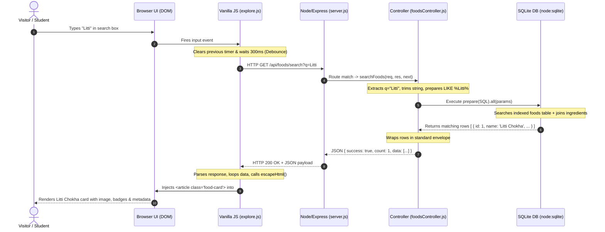

# Bharat Bhojan – Simple System Architecture & Request Lifecycle

A clear, step-by-step technical guide explaining how data flows through the Bharat Bhojan application, illustrated with a real-world example: searching for **"Litti Chokha"**.

---

## 1. High-Level Architectural Diagram

Bharat Bhojan follows a classic, clean **Client-Server 3-Tier Architecture** implemented with the **Model-View-Controller (MVC)** design pattern:

```
+-------------------------------------------------------------------------+
|                              CLIENT TIER                                |
|   Browser: HTML5 Pages + CSS Styling + Vanilla JavaScript (Fetch API)   |
+-------------------------------------------------------------------------+
                                    |   ^
                    HTTP GET / POST |   | JSON Data / Static Assets
                                    v   |
+-------------------------------------------------------------------------+
|                              SERVER TIER                                |
|   Node.js Runtime + Express.js Framework                                |
|   - Express Static Middleware (Serves HTML, CSS, JS, SVGs)             |
|   - Express Session & Auth Middleware (Route Guards)                   |
|   - REST API Routers (/api/foods, /api/metadata, /api/admin)            |
|   - Controllers (Business Logic, Input Validation, SQL Preparation)     |
+-------------------------------------------------------------------------+
                                    |   ^
           Parameterized SQL Query  |   | Rows / Results Set
                                    v   |
+-------------------------------------------------------------------------+
|                             DATABASE TIER                               |
|   SQLite Relational Database (bharat_bhojan.db via node:sqlite)        |
|   - 11 Normalized Tables in 3NF (Primary Keys, Foreign Keys)            |
|   - B-Tree Indexes on Foreign Keys and Unique Slugs                     |
|   - ACID Transactions for Seed and Admin Operations                     |
+-------------------------------------------------------------------------+
```

---

## 2. Real-World End-to-End Trace: Searching for "Litti Chokha"

Here is the exact 10-step lifecycle when a user visits the **Explore Foods** page and types `"Litti"` into the search box:



### Step-by-Step Technical Explanation

#### Step 1: User Action in Browser
The user navigates to `http://localhost:3000/explore.html` and types `"Litti"` into `<input type="text" id="searchInput">`.

#### Step 2: Client-Side Debouncing (`public/js/explore.js`)
Without debouncing, every single keystroke (`'L'`, `'Li'`, `'Lit'`, `'Litt'`, `'Litti'`) would trigger a separate HTTP request to the server. 
In `explore.js`:
```javascript
let searchTimer = null;
searchInput.addEventListener('input', () => {
    clearTimeout(searchTimer);
    searchTimer = setTimeout(() => {
        applyFiltersAndSearch();
    }, 300); // Wait 300ms after user stops typing
});
```
This ensures only one network request is dispatched when the user pauses.

#### Step 3: HTTP Network Request
The browser executes an asynchronous `fetch()` call:
```javascript
const response = await fetch('/api/foods/search?q=' + encodeURIComponent('Litti'));
```
The browser sends an HTTP GET request to the local server port 3000.

#### Step 4: Express Routing (`routes/foods.js`)
`server.js` mounts the foods router at `/api/foods`:
```javascript
app.use('/api/foods', foodsRouter);
```
Inside `routes/foods.js`, Express matches the route:
```javascript
router.get('/search', foodsController.searchFoods);
```

#### Step 5: Controller Logic (`controllers/foodsController.js`)
The controller extracts the query string parameter:
```javascript
const query = (req.query.q || '').trim();
if (!query) {
    return res.json({ success: true, count: 0, data: [] });
}
```

#### Step 6: Parameterized SQL Query Execution (`config/database.js`)
The controller queries the database using parameterized SQL to prevent SQL injection:
```javascript
const searchTerm = `%${query}%`;
const sql = `
    SELECT 
        f.id, f.name, f.local_name, f.slug, f.short_description,
        f.veg_type, f.image_url, f.featured,
        s.name AS state_name,
        r.name AS region_name,
        c.name AS category_name
    FROM foods f
    JOIN states s ON f.state_id = s.id
    JOIN regions r ON f.region_id = r.id
    JOIN categories c ON f.category_id = c.id
    WHERE f.name LIKE ? 
       OR f.local_name LIKE ? 
       OR f.short_description LIKE ?
       OR EXISTS (
           SELECT 1 FROM food_ingredients fi
           JOIN ingredients i ON fi.ingredient_id = i.id
           WHERE fi.food_id = f.id AND i.name LIKE ?
       )
    ORDER BY f.name ASC
`;
const results = queryAll(sql, [searchTerm, searchTerm, searchTerm, searchTerm]);
```

#### Step 7: SQLite Database Engine
The query executes inside `bharat_bhojan.db` using Node's native `node:sqlite` engine. SQLite utilizes B-Tree indexes on foreign keys (`state_id`, `region_id`, `category_id`) to perform fast joins and string matching.

#### Step 8: Standardized JSON Response
The controller formats the result into a clean API response envelope and sends HTTP 200:
```javascript
res.json({
    success: true,
    query: query,
    count: results.length,
    data: results
});
```

#### Step 9: Client-Side Parsing & Sanitization (`public/js/explore.js`)
The frontend receives the JSON payload, checks `response.ok`, and loops through the array of dishes. Every text field is sanitized using `escapeHtml()` to neutralize potential XSS payloads:
```javascript
const cardsHtml = foods.map(food => `
    <article class="food-card">
        <div class="food-card-image-wrap">
            
            <span class="diet-indicator ${food.veg_type === 'Vegetarian' ? 'veg' : 'non-veg'}">
                <span class="diet-indicator-dot"></span>
            </span>
        </div>
        <div class="food-card-body">
            <div class="food-card-meta">
                <span>📍 ${escapeHtml(food.state_name)}</span>
                <span>🏷️ ${escapeHtml(food.category_name)}</span>
            </div>
            <h3 class="food-card-title">${escapeHtml(food.name)}</h3>
            <p class="food-card-native-name">${escapeHtml(food.local_name || '')}</p>
            <p class="food-card-desc">${escapeHtml(food.short_description)}</p>
            <a href="/food.html?slug=${encodeURIComponent(food.slug)}" class="btn btn-secondary btn-sm">
                Explore Culinary Traditions →
            </a>
        </div>
    </article>
`).join('');
```

#### Step 10: DOM Update & Rendering
JavaScript assigns `document.getElementById('foodsGrid').innerHTML = cardsHtml;`. The browser recalculates CSS styles, updates the layout, and displays the card for **Litti Chokha** with its native Devanagari script, state badge, and photo illustration.

---

## 3. Directory Structure and Responsibilities

```
bharat-bhojan/
│
├── config/                     # Configuration and database connectivity
│   └── database.js             # SQLite connection wrapper using node:sqlite, prepared statements & transactions
│
├── database/                   # Database schemas and data population
│   ├── schema.sql              # Normalized SQLite ANSI DDL (11 tables, constraints, indexes)
│   ├── seed.js                 # Automated seed script (37 dishes, 12 references, 25 states, 6 regions)
│   ├── create-admin.js         # Dedicated CLI tool for administrative credential provisioning
│   └── generate-assets.js      # Procedural SVG image generator producing 38 offline food illustrations
│
├── controllers/                # Application business logic (MVC Controllers)
│   ├── foodsController.js      # Public handlers: listing, search, filtering, slug details, stats
│   ├── metadataController.js   # Master lookups: states, regions, categories, seasons, references
│   └── adminController.js      # Protected handlers: auth, session checking, dashboard, CRUD operations
│
├── routes/                     # HTTP URL route definitions (MVC Routing)
│   ├── foods.js                # Public /api/foods endpoints
│   ├── metadata.js             # Public /api/metadata, /api/states, /api/regions endpoints
│   └── admin.js                # Session-protected /api/admin endpoints
│
├── middleware/                 # Express middleware functions
│   ├── auth.js                 # Session guard verifying req.session.adminUser (401 JSON or redirect)
│   └── errorHandler.js         # Centralized error handler returning structured JSON & logging errors
│
├── public/                     # Public client-side assets served statically
│   ├── index.html              # Landing page (hero, live database stats, featured foods, quick search)
│   ├── explore.html            # Main exploration portal with multi-criteria filters and debounced search
│   ├── food.html               # Comprehensive single-dish detail view (culture, preparation, ingredients)
│   ├── regions.html            # Regional portal (6 zones, state pills, interactive zone switcher)
│   ├── seasonal.html           # Seasonal portal (6 seasons, Ritu philosophy, seasonal foods grid)
│   ├── about.html              # Academic scope, IKS foundation, tech stack, honest limitations
│   ├── references.html         # Annotated bibliography of 12 verified academic/government sources
│   ├── 404.html                # Friendly custom 404 error page with navigation links
│   ├── css/
│   │   ├── style.css           # Global theme, CSS custom properties, cards, badges, navbar, typography
│   │   └── responsive.css      # Responsive media queries down to 360px mobile viewports
│   ├── js/
│   │   ├── main.js             # Shared frontend logic: mobile hamburger menu, live stats, escapeHtml()
│   │   ├── explore.js          # Multi-criteria filter engine, debounced live search, dynamic card grid
│   │   ├── food.js             # Slug-driven detail loader, conditional sections, related dishes
│   │   ├── regions.js          # Zone switcher, state pills, region-specific dish renderer
│   │   └── seasonal.js         # Season tabs, Ritu descriptions, seasonal food renderer
│   └── assets/
│       └── images/             # 38 local SVG illustrations for completely offline operation
│
├── admin/                      # Administrative portal assets
│   ├── login.html              # Secure admin sign-in form with accessible feedback alert
│   ├── dashboard.html          # Administrative management dashboard with metrics and data table
│   ├── food-form.html          # Unified form for adding and editing traditional food records
│   ├── admin.css               # Clean administrative styling
│   └── admin.js                # Admin JS: session verification, dynamic form population, AJAX CRUD
│
├── docs/                       # Comprehensive academic documentation and viva study guides
│   ├── viva-survival.md        # Top 20 viva questions, crisp 2-5 sentence answers, elevator pitches
│   ├── simple-architecture.md  # Architecture overview and Litti Chokha lifecycle trace
│   ├── database-viva.md        # Deep dive into schema, 3NF, keys, junction tables, and transactions
│   ├── code-study-guide.md     # Top 15 codebase files, important functions, and sample viva questions
│   ├── 7-day-project-learning-plan.md # Day-by-day study roadmap for a BCA student
│   ├── data-quality-report.md  # Verified statistical report on dataset integrity and citations
│   ├── final-audit.md          # Complete audit log of enhancements and fixes
│   ├── viva-notes.md           # Master bank of ~60 categorized questions and answers
│   ├── mysql-schema.sql        # MySQL-compatible schema script for viva discussions
│   └── testing.md              # Documentation of the 43-assertion automated verification suite
│
├── server.js                   # Application entry point: Express setup, middleware, static routes, start listener
├── test-system.js              # Automated end-to-end integration test suite (43 assertions across 23 scenarios)
├── package.json                # Project manifest with minimal 4 dependencies (express, dotenv, express-session, bcryptjs)
└── README.md                   # Comprehensive project documentation with setup and quickstart instructions
```
